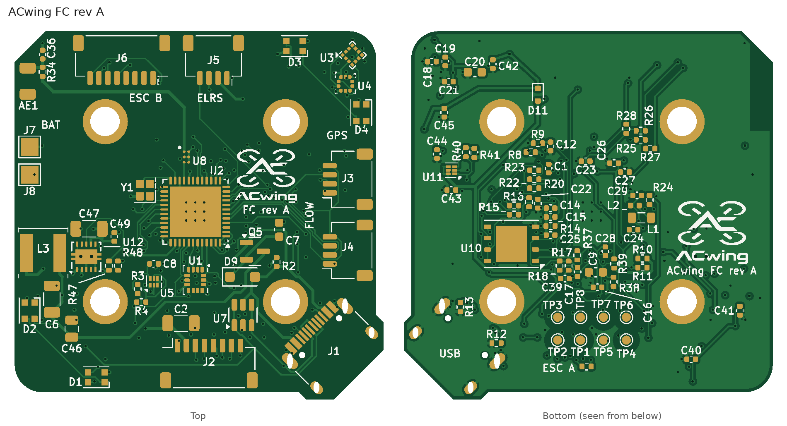

# ACwing FC rev A – universal flight controller: 1S–6S, commercial 4-in-1 ESCs, up to 8 motors

**Project:** ACwing · **Author:** Andrea Cirillo · **Overview:** [repository README](../../Readme.md)



> **Revisions.** Rev A is the first released revision. Earlier letters, marked *draft* in this document (drafts C–G), are internal design iterations that were never manufactured.

KiCad 7 project (it also opens in KiCad 8/9). Rev A turns the FC into a **standard FC that works with any power
stage that uses the common 4-in-1 ESC connector**:
- **Mini drone (1S, brushed coreless):** the ACwing 1S power board (ACwing ESC 1S rev A) carries the
  motor stages, the battery connector and pads, the 1S USB-C charger and the current sensor. To the FC it looks like
  any ESC: VBAT (1S) and CUR on the 8-pin cable.
- **Larger drone (3S–6S brushless, payload > 2 kg):** a commercial 20 × 20 4-in-1 ESC replaces the power board and
  supplies the FC through the same cable. Hexa / octo frames add a second 4-in-1 ESC on ESC link B.

The FC has one USB-C port for data, DFU flashing and bench supply only. Battery charging lives on the 1S power board
(its own USB-C), because only the 1S battery can be charged that way.

## Layout update (2026-10-24, still rev A: no board made yet)
| Item | Before | Now | Why |
|---|---|---|---|
| **MCU U2** | (−3.0, +3.0) | **(0, 0), board centre** | symmetric layout; RF line to the antenna 22.4 mm (≈ 0.2 dB more loss than before), 50 Ω microstrip over solid In1 GND |
| **IMU U1** | (0, −3.6), rot 0 | **(0, −7.6), rot 270** | room for the pin escape south of the centred MCU; INT1 / MISO face MCU pins 42 / 44 (straight pre-routed lines). **Firmware: remap the IMU axes** (sensor X = board −v, Y = board +u) |
| **J6 ESC link B** | left edge | **front edge, next to J5 (ELRS)**, same mouth direction, centre (−8.2, +16.85) | both cable ports together on the front edge; J6 body ≥ 3.4 mm from the antenna keep-out |
| **Input buck U12 / L3** | rear-left corner, between the rear LEDs D1 / D2 | **left edge** (old J6 spot): L3 (−16.9, −4.6), U12 (−12.1, −5.0) | L3 no longer between the two LEDs; 41 mm from the magnetometer, 17 mm from the IMU |
| LDO U5, C8, R3, R4 | south of the IMU | west of the IMU, (−4.6, −7.8) | IMU escape channel |
| **LEDs D3 / D4** | supply pins toward the magnetometer | **rotated 180°**, supply (VLED) pre-routed on B.Cu from D11 along the board interior | the LED current changes with the colour: kept ≥ 4.8 mm from the magnetometer (was 3.9 mm, and a LED data line crossed it) |

Stack: the GPS board Qwiic J1 moved to v = +3.6 so it sits right above FC J3 (straight cable). The ESC link (FC J2 /
ESC J1) stays 8 mm offset: FC J2 can move only 0.8 mm before the USB-C, and ESC J1 cannot reach the rear-edge centre
(motor M1 pads, fixed by the frame).

## EMI check (magnetometer U3, IMU U1)
`generator/emi_check.py`: Biot–Savart on every routed track of the current-carrying nets (contributions added in
magnitude, no cancellation by the return path: an upper bound), dipole estimate for the inductors, distances on every
layer, In1 GND under the sensors.

| Source at the magnetometer | Before | Now |
|---|---|---|
| LED supply VLED (144 mA at full white, **varies with the colour**) | 6.3 µT, LED data line under the sensor | **4.7 µT**, nothing crosses the sensor |
| VSYS / VBAT / VBUS / VEXP / VDD / VREG (DC, calibrated as hard iron) | 18.0 µT | 14.9 µT |
| Buck switch node / L3 stray field | 0.23 / 0.02 µT | 0.39 / 0.03 µT |
| Closest aggressor copper | LED data line 0 mm | LED data line 3.4 mm, VLED 4.1 mm |

- Magnetometer: In1 GND 84 % under the sensor (+1 mm), no slots. The only colour-dependent term is the LED supply:
  firmware either compensates it (LED current is known from the commanded colour) or keeps the LED pattern fixed while
  the compass is used. The motor currents on the ESC 1S below (≈ 2 µT per motor at full throttle, 18 mm away) are
  throttle-dependent: calibrate them with a throttle/compass fit. Outdoors, use the GPS board compass for the heading.
- IMU: nearest switching node ≥ 7 mm (STM32 SMPS L1), buck ≥ 12 mm; In1 GND 83 % under the IMU, no slots. Only the
  USB 5 V (DC, bench) and the ELRS UART (≥ 1.7 mm) pass nearby: no concern for a digital MEMS sensor. Vibration remains
  the dominant disturbance (tap test on the first build).

## Changes from draft G
| Item | Draft G | Rev A | Why |
|---|---|---|---|
| **Input converter** | TPS62160 buck, 3–17 V (1S–3S) | **U12 LM5166DRCT**: 3–65 V in (abs. max 68 V), 500 mA, PFM, PFET high side with 100 % duty cycle, L3 22 µH (SWPA5040S, Isat 1.9 A), C47 4.7 µF 50 V + C49 10 nF in, C6 100 µF + C46 22 µF out, R47/R48 470k/200k → **VREG 4.1 V** | one converter for **1S–6S** with margin for ESC voltage spikes; on 1S it passes the battery through (VREG ≈ VBAT − I × 1.1 Ω), as drafts F/G did |
| RC filter R1 / C6 | 1 Ω + 100 µF on VREG | removed (C6 is now the buck output capacitor) | VREG is regulated |
| **USB charger, 1S charge gate** | U6 STC4054, D10, R5–R7, C10, C11; Q6/Q7, R43, R45 | **removed** | charging moves to the 1S power board |
| **External current input** | TP9/TP10 → PA6 | removed | PA6 is now motor M8 |
| **Motor outputs** | 4 (TIM2) | **8**: M1–M4 TIM2 (J2), M5–M7 TIM1 CH1–CH3 (PA8–PA10), M8 TIM16 CH1 (PA6) on **ESC link B (J6)** | hexa / octo frames with two 4-in-1 ESCs |
| **ESC link B (new)** | – | J6 JST SH 8-pin, top side, **front edge next to J5** (layout update), mouth toward the front; R25–R28 100 Ω; pins 2–4 (VBAT, CUR, TLM) open | same connector and cable as ESC link A; two ESC supplies are never tied together on the FC |
| **Battery pads (new)** | – | J7 VBAT+ / J8 GND, 2 × 2 mm, top side, left edge | FC supply when the ESC has no VBAT pin (separate ESCs, PDB) |
| **Second Qwiic port (new)** | J3 only | J3 (right edge, front) + **J4 (right edge, rear)** in parallel | GPS board and flow board get their own cables; no daisy chain under the stack |
| ELRS (J5) | USART1 PA9/PA10 | USART1 **PB6/PB7** (alternate pins) | PA9/PA10 are TIM1 for M6/M7 |
| RGB LEDs | PB6 TIM16_CH1N | **PA7 TIM17_CH1** + DMA | PB6 is USART1 TX |
| ESC A telemetry | PB7 | PB0 (GPIO/EXTI, optional) | bidirectional DShot / EDT is the main telemetry path |
| VBAT sense | 470k/100k (17 V max) | **100k/10k**: × 1/11, 25.2 V → 2.29 V, full scale 34 V | 6S |
| C2 (VBAT at J2) | 10 µF 25 V 0805, bottom | 4.7 µF **50 V** 1206 X7R, top | 6S; the 1206 is too tall for the bottom side |
| Power path | Q5 / D9 rear-left | same circuit, moved east of the IMU | the input buck takes the rear-left corner |

Outline: frame C + 0.8 mm USB-corner step as drafts F/G, plus a **front-left chamfer** v − u = 36.6 (stack check with the
power board rev A charge port below; the chip antenna stays inside, DRC 0). Unchanged: 20 × 20 grommet holes, MCU / IMU / compass / baro / flash,
RF front end and antenna, LDOs U5 (3.1 V) and U11 (VEXP 3.31 V), 4 RGB LEDs and their positions, J1 USB-C, J2 ESC A,
J3 Qwiic, J5 ELRS positions, pogo grid.

## Supported configurations
| Power stage | Battery | VREG | Charging | Current measurement |
|---|---|---|---|---|
| ACwing 1S power board (brushed coreless) | 1S | ≈ VBAT (100 % duty cycle) | on the power board (its USB-C) | CUR pin, 0.1 V/A |
| Commercial 20 × 20 4-in-1 ESC (2–6S class) | 2S–6S | 4.1 V | external balance charger | CUR pin (scale in firmware) or EDT |
| Two 4-in-1 ESCs (hexa / octo) | 2S–6S | 4.1 V | external | ESC A CUR + EDT on all motors |
| Separate ESCs + PDB | 2S–6S | 4.1 V | external | EDT; FC supplied on the J7/J8 pads |

- **Maximum 6S (25.2 V).** LM5166 abs. max is 68 V, so 6S has a wide margin for regenerative spikes. The 50 V input
  capacitors and the 100k/10k divider (34 V full scale) set a practical limit of 6S–7S.
- **FC load on VREG ≤ 0.5 A** (LM5166). Typical load: MCU + BLE + sensors ≈ 60 mA, ELRS receiver 50–150 mA, GPS board
  ≤ 100 mA, flow board 35 mA, 4 LEDs up to 150 mA at full white.
- **1S end of discharge:** below about 3.3 V the 3.1 V LDO (VDD) and the 3.31 V VEXP leave regulation (dropout).
  The buck itself runs down to 2.45 V. Same behaviour as drafts F/G.

## Power architecture
```
ESC A J2 pin 2 ─┐
J7 / J8 pads ───┴─ VBAT 1S–6S ── U12 LM5166 (PFM) ── VREG 4.1 V ── Q5 ──┬── VSYS ── U5 LDO 3.1 V (VDD: MCU, sensors)
                         │                                           │         ├─ U11 LDO 3.31 V (VEXP: Qwiic J3/J4)
                         └─ R8/R9 → VBAT_SNS (PA5)          USB VBUS ── D9 ─┘         ├─ D11 → VLED (4 × WS2812B)
                                                                                        └─ J5 ELRS supply
```
- Q5 (AO3401A) is on with the battery only; USB on its gate turns it off, so USB never back-feeds the buck or the
  ESC (the LM5166 high-side body diode would otherwise connect VREG to VBAT).
- Q5's body diode points from VREG to VSYS. With USB and battery both present, VSYS comes from USB (4.65 V > 4.1 V –
  body-diode drop).

## ESC link A (J2) and ESC link B (J6)
| Pin | J2 (ESC A, rear edge) | J6 (ESC B, front edge) |
|---|---|---|
| 1 | GND | GND |
| 2 | VBAT 1S–6S → U12, VBAT_SNS, C2 | open |
| 3 | CUR → R42 1 k → PA4 (ADC IN9), C1 | open |
| 4 | TLM → R24 100 Ω → PB0 (optional) | open |
| 5–8 | M1–M4 → 100 Ω → PA0–PA3 (TIM2 CH1–CH4) | M5–M8 → 100 Ω → PA8, PA9, PA10 (TIM1 CH1–CH3), PA6 (TIM16 CH1) |

1:1 JST SH 8-pin cables, ≈ 50 mm. Check the pin order of any third-party ESC before plugging it in; re-pin the
cable if it differs.

## Firmware pin map (rev A)
See `ACwing_FC_A_pinmap.md`. Summary:
| Function | Pin | Peripheral |
|---|---|---|
| Motors M1–M4 / M5–M7 / M8 | PA0–PA3 / PA8–PA10 / PA6 | TIM2 CH1–CH4 / TIM1 CH1–CH3 / TIM16 CH1, all with DMA: 32 kHz PWM (brushed) or DShot300/600 + bidirectional DShot / EDT |
| ESC current / VBAT sense | PA4 / PA5 | ADC1 IN9 / IN10 |
| ESC A telemetry (optional) | PB0 | GPIO / EXTI (software UART) |
| ELRS (J5) | PB6 TX / PB7 RX | USART1, CRSF 420 kbaud |
| SPI1 IMU + flash | PB3 / PB4 / PB5, CS PC14 (IMU), PE4 (flash) | SPI1 |
| IMU INT1 / RGB LEDs / VBUS detect | PA15 / PA7 / PB1 | EXTI / TIM17 CH1 + DMA / GPIO |
| Qwiic J3 + J4 / USB / SWD / BOOT0 / HSE | PB8–PB9 / PA11–PA12 / PA13–PA14 / PH3 / 32 MHz | as draft F |

- Free: PB2. Not connected: PC15. No second UART is free: GNSS goes on I2C (ACwing GPS, u-blox DDC).

## Add-on boards
- **GPS board (ACwing GPS rev A)**, optional (outdoor variant), stacked above on the 20 × 20 holes with a **6 mm** gap
  (GPS rev A has its Qwiic connectors on the top side; the GPS draft C needed 8 mm): cable from FC **J3** (right edge, front) to
  GPS J1 (right edge). GPS J2 is an optional pass-through.
- **Flow board (ACwing Flow rev A)**, under the frame: cable from FC **J4** (right edge, rear) down through the deck to
  flow J1.
- Bus addresses: GNSS 0x42, GPS compass 0x1E, ToF 0x29, flow bridge 0x3B (no clash). VEXP 300 mA covers both boards.

## Placement (board frame u right, v front; FC top view)
| Part | Where |
|---|---|
| U2 MCU | top, **(0, 0)**, rot 180; MLPF U8 (−1.0, +6.1), crystal Y1 (−5.6, +2.4) |
| U1 IMU | top, (0, −7.6), rot 270; LDO U5 (−4.6, −7.8) west of it |
| U12 LM5166, L3 (5 × 5 × 4 mm), C47, C49, R47/R48 | top, **left edge**: L3 (−16.9, −4.6), U12 (−12.1, −5.0), C47 (−11.8, −1.9) rot 180 (VBAT pad toward U12 pin 7), C49 (−9.0, −2.8) |
| C6, C46 (VREG bulk) | top, (−15.9, −9.7), (−13.7, −13.0) |
| C2 (VBAT at J2) | top, (−1.6, −12.4) |
| Q5, D9, C7, R2 (power path) | top, east of the IMU, (+6.6, −4.4) / (+5.2, −7.3) |
| J2 ESC A | top, rear edge, (+1.5, −16.9), mouth −v |
| **J6 ESC B** | top, **front edge**, (−8.2, +16.85), mouth +v; pins v = +14.85, u = −4.7 (pin 1) … −11.7 (pin 8) |
| J5 ELRS | top, front edge, (+2.0, +16.85), mouth +v |
| **J7 VBAT+ / J8 GND** | top, left edge, (−18.4, +7.2) / (−18.4, +4.1); "+" / "−" on the silkscreen |
| J3 Qwiic (GPS) | top, right edge, (+16.9, +3.6), mouth +u; GPS J1 right above it |
| J4 Qwiic (flow) | top, right edge, (+16.9, −4.3), mouth +u |
| LEDs D1–D4 | top: D1 (−11.0, −18.4), D2 (−18.4, −11.0), D3 (+11.0, +18.4) rot 180, D4 (+18.4, +11.0) rot 270 |
| U3 magnetometer, U4 baro | top, front-right corner, (+17.4, +17.4) / (+16.6, +14.2) |
| J1 USB-C, antenna AE1, pogo grid, flash U10 (bottom) | J1 (+15.8, −15.8) at the chamfer, AE1 left edge front, pogo grid bottom rear centre, U10 bottom (+8.9, −3.6) |

## PCB
- 4 layers, 1.0 mm, stack-up and rules as drafts F/G. Net class **HV** (VBAT, BUCK_SW): 0.3 mm tracks, 0.15 mm
  clearance (6S). VREG in the Power class (0.3 mm).
- U12: GND pins (3 ILIM, 5 RT, 10) tied straight into the exposed pad, two 0.3 mm vias in the pad to the In1 GND plane;
  VIN pin 7 pre-routed (0.3 mm) to C47.
- Routing: 1342 tracks, 212 vias. Locked pre-routes: RF chain, crystal, MCU ground, DFN / VSON details, pogo stubs, GND
  fan-out, IMU fan-out (INT1, MISO) and escape vias (SHUB_SCL / SDA, SPI_SCK), LED supply to D3 / D4; the rest
  Freerouting plus A* for the last connections. Some VSYS / VBUS runs on In2 are 0.2 mm (≤ 0.3 A, inner layer).

## Checks
- Netlist: 0 errors (`check_net.py`, 91 nets).
- KiCad DRC (`ACwing_FC_A_DRC.rpt`): **0 violations, 0 unconnected pads, 0 footprint errors**.
- EMI check (`emi_check.py`): see above.
- Silkscreen: 102 references on the board (R21, R42 on the Fab layer only: no free spot), 9 with a leader line.

## Fabrication (JLCPCB)
- 4 layers, 1.0 mm FR-4; parts on both sides (top 36, bottom 57).
- New LCSC parts: **LM5166DRCT C181495** (350 in stock on 2026-10-18: check before ordering), SWPA5040S220MT C68434,
  4.7 µF 50 V 1206 X7R C29823 (Basic), 470 kΩ C25790, 200 kΩ C25764, 10 nF 50 V C15195.
- CPL: rotation corrections as drafts F/G. U12 (VSON-10, DRC) has no learned correction yet: 270° as the DFN/QFN parts of
  this board. **Check U12 pin 1 in the JLC preview**, with J2/J6 (tabs toward the edges) and the LED marks.
- **Cost:** about **28.2 USD per board at 10 boards, 22.7 USD at 100** (components only; draft G 26.1 / 20.6). The LM5166
  (3.7 USD) replaces the TPS62160 + charger + charge gate (≈ 2.4 USD).

## To check before ordering
1. ERC in KiCad 8/9.
2. LM5166 stock at LCSC/JLC (350 pcs on 2026-10-18).
3. Bench test of the buck at 1S (3.0–4.2 V, 100 % duty cycle) and 6S (25.2 V), with the full FC load: VREG ripple
   (PFM, 1.25 A peak) after the LDOs, and LDO dropout at the 1S end of discharge.
4. C6/C46 effective capacitance at 4.1 V (≈ 50 µF together, against ≈ 100 µF asked for PFM by the datasheet
   formula): fine for the LDOs downstream; add a second 22 µF 0805 near L3 if the ripple is high.
5. Antenna tuning with the board above the ESC; JLC CPL preview (U12).

## Contents
| File | What |
|---|---|
| `ACwing_FC_A_pcb.png` | top and bottom PCB views (mask, pads, silkscreen) |
| [`ACwing_FC_A_schematic.pdf`](ACwing_FC_A_schematic.pdf) | schematic |
| [`ACwing_FC_A_pinmap.md`](ACwing_FC_A_pinmap.md) | pin map, ESC links, add-on ports |
| `ACwing_FC_A_BoM.xlsx` | assembly BoM (sheet `BoM`) and costing (sheet `Costing`) |
| `ACwing_FC_A_BoM_JLCPCB.xlsx`, `ACwing_FC_A_CPL.xlsx` | JLCPCB BoM (LCSC part numbers) and pick-and-place with rotation corrections (93 parts) |
| `ACwing_FC_A_gerber.zip` | Gerber (4 copper layers) + Excellon drill files, origin at the lower-left corner: upload as is to JLCPCB |
| `ACwing_FC_A_DRC.rpt` | KiCad DRC report (0 violations, 0 unconnected pads) |
| `ACwing_FC_A.step`, `ACwing_FC_A_3D.png`, `ACwing_FC_A_routing.png` | STEP of the assembled board, 3D renders, copper routing |
| `ACwing_FC_A_outline.dxf` | mechanical outline for the frame design |

KiCad sources in [`01 - FC_KiCadProj/`](../../01%20-%20FC_KiCadProj/):

| File | What |
|---|---|
| `ACwing_FC_A.kicad_pro / .kicad_sch / .kicad_pcb` | KiCad 7 project, schematic, routed PCB |
| `ACwing.kicad_sym`, `ACwing.pretty/`, `3d/` | project library (symbols, footprints incl. the ACwing logos) and STEP models |
| `generator/` | scripts that generated and checked the design (see Regeneration) |

## Regeneration
`generator/build_all_h.sh` (helpers from the draft E generator, Freerouting 1.9 capped at 20 min). The result changes
with any placement change: check the DRC after editing the placement.

> The generator scripts were run in the original build environment: absolute paths inside them (`/home/claude/...`) must be adapted before running them again. The ACwing logos and silkscreen labels were added afterwards with the tools in `00 - Docs/05 - Brand/tools/`.

## Sources
- [TI LM5166 datasheet](https://www.ti.com/lit/ds/symlink/lm5166.pdf), [LCSC C181495](https://www.lcsc.com/product-detail/DC-DC-Converters_TI_LM5166DRCT_LM5166DRCT_C181495.html)
- [TI TPS55165-Q1 datasheet](https://www.ti.com/lit/ds/symlink/tps55165-q1.pdf): rejected, needs VIN ≥ 5.3 V to start (no 1S start)
- [TI LMR36506 datasheet](https://www.ti.com/lit/ds/symlink/lmr36506.pdf): smaller and cheaper, but its 2 × 2 mm VQFN-HR land pattern could not be verified here
- [Sunlord SWPA5040S220MT (JLCPCB C68434)](https://jlcpcb.com/partdetail/Sunlord-SWPA5040S220MT/C68434)
- ST pin data `STM32WB55CGUx.xml` (STM32_open_pin_data) for the alternate functions

