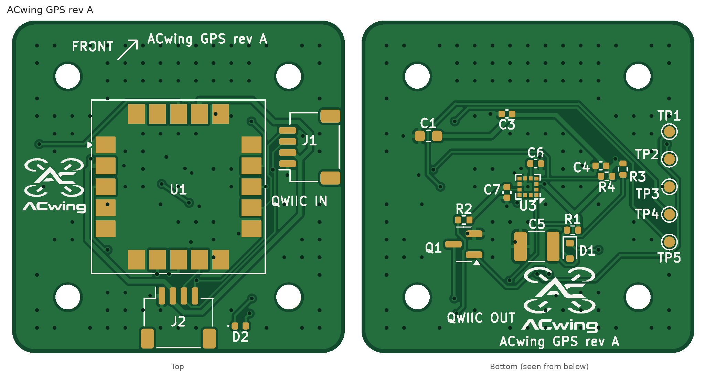

# ACwing GPS rev A – GNSS + compass expansion board for ACwing FC rev A

**Project:** ACwing · **Author:** Andrea Cirillo · **Overview:** [repository README](../../Readme.md)



> **Revisions.** Rev A is the first released revision. Earlier letters, marked *draft* in this document (drafts A–C), are internal design iterations that were never manufactured.

> **Layout update (2026-10-24, still rev A).** Qwiic J1 moved from v = 0 to v = +3.6, right above FC J3; re-routed,
> DRC 0. Nothing else changed.

KiCad 7 project (it also opens in KiCad 8/9). A 30 × 30 mm board that stacks on top of the flight controller on the
same **20 × 20 mm** holes, on **6 mm** nylon standoffs. Circuit identical to drafts B/C (Qwiic expansion bus, GNSS on
DDC, compass).

## Changes from draft C
| Draft C | Rev A | Why |
|---|---|---|
| Qwiic J1 / J2 on the bottom side | **J1 / J2 on the top side**: J1 right edge (11.88, **+3.6**, right above FC J3), mouth +u; J2 rear edge (0, −11.88), mouth −v | stack check with mated plugs: on the bottom, the J1 plug sat right above FC rev A J3/J4 and hit them (−0.6 mm at 6 mm standoffs) |
| SAM-M10Q rotated 45° | **SAM-M10Q axis-aligned (0°)**, centred | the 45° module leaves only 4 mm at the edge midpoints; at 0° there are 7.25 mm strips for the connectors |
| 8 mm standoffs needed with FC rev A | **6 mm standoffs** (as designed): bottom side ≤ 1.1 mm (compass, backup, test pads) | stack check: 0 clashes, closest items 0.39 mm (mounting hardware, unchanged) |

Schematic: notes and title block only. Same LCSC parts, same firmware, same compass rotation matrix.

### Notes on the change
- The connectors (2.9 mm) sit 0.6 mm from the module side walls (6.3 mm). They are lower than the antenna top and
  outside the module footprint; GNSS performance should be checked outdoors (C/N0) against draft C.
- Cable: FC J3 (FC top, right edge) → GPS J1 (GPS top, right edge, aligned with FC J3), a short straight loop outside the right edge.
  GPS J2 is a pass-through only: the flow board now has its own FC port (J4).

## Changes from draft A (kept in draft B and C)
| Draft A | Draft B | Why |
|---|---|---|
| JST SH 6-pin link (UART + I2C + VIN) to FC J3 draft D | **two Qwiic ports** (JST SH 4-pin, pass-through): J1 in (right edge), J2 out (rear edge) | draft E has one shared expansion bus for GPS and flow boards; J2 continues the chain down to the flow board |
| GNSS on the FC UART (USART1) | GNSS on **DDC (I2C, 0x42)** on the bus | USART1 is the ELRS port on draft E; u-blox M10 DDC carries the same UBX/NMEA stream |
| UART to the FC | UART on test pads TP4 TXD / TP5 RXD | u-center and firmware updates with a 3.3 V USB-UART |
| AP2112K LDO from FC VSYS | **no LDO**: 3.3 V from the FC expansion LDO (VEXP, 300 mA) | the bus already carries a clean, dedicated 3.3 V rail |
| — | GND fan-out via for every small GND pad | keeps every ground pad tied to the plane when tracks cut the pour |

Unchanged from draft B: IIS2MDC compass at the board centre (bottom), supercap backup (R1, D1, C5),
PPS LED (D2/Q1/R2), safeboot/reset pads, M2 holes and the stack.

## Contents
| File | What |
|---|---|
| `ACwing_GPS_A_pcb.png` | top and bottom PCB views (mask, pads, silkscreen) |
| [`ACwing_GPS_A_schematic.pdf`](ACwing_GPS_A_schematic.pdf) | schematic |
| `ACwing_GPS_A_BoM.xlsx` | assembly BoM (sheet `BoM`) and costing (sheet `Costing`) |
| `ACwing_GPS_A_BoM_JLCPCB.xlsx`, `ACwing_GPS_A_CPL.xlsx` | JLCPCB BoM (LCSC part numbers) and pick-and-place with rotation corrections (15 parts) |
| `ACwing_GPS_A_gerber.zip` | Gerber (2 copper layers) + Excellon drill files, origin at the lower-left corner: upload as is to JLCPCB |
| `ACwing_GPS_A_DRC.rpt` | KiCad DRC report (0 violations, 0 unconnected pads) |
| `ACwing_GPS_A.step`, `ACwing_GPS_A_3D.png` | STEP of the assembled board, 3D renders |

KiCad sources in [`03 - GPS_KiCadProj/`](../../03%20-%20GPS_KiCadProj/):

| File | What |
|---|---|
| `ACwing_GPS_A.kicad_pro / .kicad_sch / .kicad_pcb` | KiCad 7 project, schematic, routed PCB |
| `ACwing_GPS.pretty/`, `3d/` | project library (symbols, footprints incl. the ACwing logos) and STEP models |
| `generator/` | scripts that generated and checked the design (see Regeneration) |

## Circuit
- **J1 / J2 (Qwiic).** JST SM04B-SRSS-TB on the top side (rev A). J1 at the right edge (mouth +X), J2 at the rear edge
  (mouth −Y). Wired in parallel: 1 GND, 2 3.3 V, 3 SDA, 4 SCL. Standard 1:1 Qwiic cables.
- **3.3 V.** From the bus (FC U11, VEXP 3.31 V). C1 10 µF at the input covers the GNSS start-up inrush (up to 100 mA).
- **GNSS U1, SAM-M10Q-00B.** VCC/V_IO on 3.3 V (C3/C4 100 nF under the pins).
  - DDC (I2C) on the bus: SDA pin 9, SCL pin 12, address 0x42, up to 400 kHz. The FC polls the DDC stream (register
    0xFD/0xFE = bytes available, 0xFF = data).
  - UART TXD/RXD only on TP4/TP5. Default 9600 baud: u-center works directly on the pads.
  - Backup: 3.3 V → R1 1 k → D1 → V_BCKP with C5 CPH3225A (11 mF), about 10 min of hot-start backup.
  - Recovery: TP1 SAFEBOOT_N, TP2 RESET_N, TP3 GND.
- **PPS LED.** D2 (top) driven by Q1 from TIMEPULSE (gate only, no pull-down on the SAFEBOOT strap).
- **Compass U3, IIS2MDCTR.** Bottom side, board centre, on the bus at 0x1E. CS to 3.3 V, C6 220 nF, C7 100 nF.
  R3/R4 4.7 k are DNP (pull-ups are on the FC).
- **Bus map.** GPS 0x42, compass 0x1E, ToF 0x29, flow bridge 0x3B.

### Compass orientation (firmware)
Same as draft A (bottom side, 0°, FC compass top side at 45°):
```
m_fc = R · m_gps,   R = [  0.7071  -0.7071   0 ]
                        [ -0.7071  -0.7071   0 ]
                        [  0        0       -1 ]
```

## Mechanics
- 30 × 30 × 1.0 mm, R2 corners, centred on the FC. 4 × M2 (Ø2.2 NPTH) on the 20 × 20 pattern, keep-out r 2.6 mm.
- Stack: FC on its grommets → 6 mm gap → GPS board (frame C2: printed S2 spacer on the M2 screw column, titanium or
  A4 stainless screws, see `04 - System_Docs`). Top of the module ≈ 13.3 mm above the FC top.
- Cables: FC rev A J3 (top, right edge, v = +3.6) → GPS J1 (top, right edge, v = +3.6): the two connectors are
  aligned, the cable goes straight up outside the right edge (layout update 2026-10-24; J1 was at v = 0).
  The flow board has its own FC port (rev A J4); GPS J2 is an optional pass-through.
- Stack check (ACwing ESC 1S A + FC A + GPS A, 6 mm standoffs, all plugs mated): no clash; wherever a GPS bottom part sits above an
  FC rev A top part the vertical gap is ≥ 3.0 mm.
- RF: as draft C, 30 mm ground plane; nothing conductive above the module. The top-side connectors stay lower than the
  module (2.9 vs 6.3 mm).

## PCB
- Rules (JLC 2-layer standard): Default 0.2/0.15 mm, Power (+3V3, GND) 0.4 mm, Fine (I2C, MAG_C1) 0.15 mm with
  0.15 mm clearance (draft B: the I2C runs are longer and pass vias). Vias 0.5/0.3 mm.
- GND pours on both layers, SAM-M10Q ground pads solid to the top pour. 127 GND vias (stitching grid + fan-out).
- Compass escape pre-routed and locked as draft A; the rest autorouted. 174 tracks, 138 vias.

## Checks
- Netlist: 0 errors (`check_net.py`, 19 nets).
- KiCad DRC: 0 violations, 0 unconnected pads, 0 footprint errors.
- Silkscreen: 22 references, plus the FRONT arrow and the board name.
- Connectors: J1 at (u, v) = (+11.9, 0), J2 at (0, −11.9), both top side.

## Fabrication (JLCPCB)
- 2 layers, 1.0 mm FR-4. Parts on both sides (top: U1, D2, J1, J2).
- U1 SAM-M10Q and C5 CPH3225A are not stocked by LCSC: consigned parts or hand soldering (as draft A).
- CPL: SOT-23 +180° (Q1). Check U1 pin 1, J1/J2 (tabs toward the edges), C5 polarity and D1 in the JLC preview.
- Cost: about **27.6 USD per board at 10 boards, 23.4 USD at 100** (components only, the SAM-M10Q is ~80 %).

## To check before ordering
1. ERC in KiCad 8/9.
2. SAM-M10Q land pattern (SAM-M8Q footprint) and DDC operation at 400 kHz with the flow board on the same bus.
3. CPH3225A land pattern.
4. JLC CPL preview.
5. Compass rotation on the bench.

## Regeneration
`generator/build_all_gps.sh` (uses `kisch.py`, `sexp.py`, `silk_refs.py`, `step_mesh.py` from the FC generator,
`gnd_bridge.py` from the flow generator and `make_3d_e.py`). Freerouting is not deterministic: `loop_route.sh` reruns
it until the DRC is clean.

> The generator scripts were run in the original build environment: absolute paths inside them (`/home/claude/...`) must be adapted before running them again. The ACwing logos and silkscreen labels were added afterwards with the tools in `00 - Docs/05 - Brand/tools/`.
